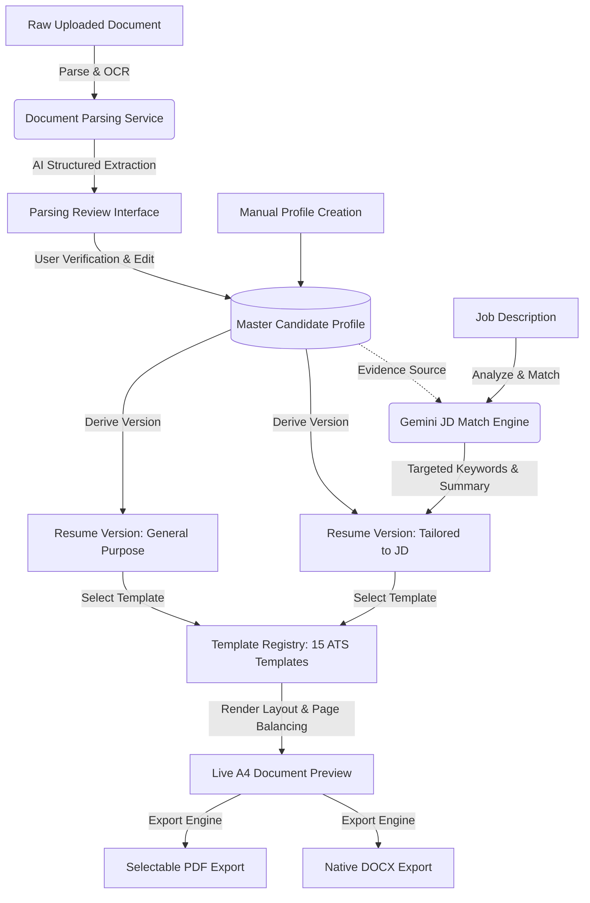

# ATS Resume Intelligence Studio - System Architecture

## 1. Overview
**ATS Resume Intelligence Studio** is a full-stack, enterprise-grade resume intelligence platform designed for high-fidelity resume extraction, structured candidate profile management, truthful AI-assisted content optimization via Google Gemini, ATS-compliant templating, live A4 document preview, and multi-format export (PDF and DOCX).

The platform operates across modern web browsers, desktop PCs, and Android mobile devices with full Progressive Web App (PWA) support and offline editing capabilities.

---

## 2. High-Level Monorepo Architecture

```
ats-resume-studio/
├── apps/
│   ├── web/                    # Next.js 14+ App Router Frontend (React, TypeScript, Tailwind CSS)
│   └── api/                    # Node.js Express Backend (TypeScript, MongoDB, Nodemailer, Gemini SDK)
├── packages/
│   ├── shared-types/           # Common TypeScript types, DTOs, and interface definitions
│   ├── resume-schema/          # Zod validation schemas for resumes, profiles, and parsing
│   ├── template-registry/      # Metadata, styling tokens, and layout configs for 15 ATS templates
│   └── resume-renderer/        # Document layout calculation, page-balancing, DOCX & PDF generators
├── docs/                       # Technical guides, architecture diagrams, and testing matrices
├── scripts/                    # Build, migration, backup, and health check scripts
├── .env.example                # Centralized environment variable blueprint
├── package.json                # Root npm workspace configuration
└── README.md                   # Project overview and quick start guide
```

---

## 3. Technology Stack & Decision Matrix

| Layer | Technology | Decision Rationale |
| :--- | :--- | :--- |
| **Frontend Framework** | Next.js (App Router) + React 18/19 | SSR/SSG capabilities, responsive routing, fast client-side navigation, PWA integration, and modern developer ergonomics. |
| **Client Styling** | Tailwind CSS + BEM Methodology | Atomic utility-first styling combined with strict Block-Element-Modifier class naming semantics for maintainable component hierarchies. |
| **Icons & Design Tokens** | Lucide React | High-contrast, lightweight, accessible SVG icon library without emoji dependencies. |
| **State Management** | Zustand & TanStack Query | Lightweight client-side UI store for live document editing paired with robust asynchronous server-state caching and deduplication. |
| **Form Management** | React Hook Form + Zod | High-performance uncontrolled form inputs with schema-driven validation, zero superfluous re-renders, and type inference. |
| **Backend Framework** | Node.js + Express.js (TypeScript) | Proven high-throughput asynchronous API layer, clear middleware chaining, separation of concerns, and full isolation from frontend execution contexts. |
| **Database & ODM** | MongoDB + Mongoose | Flexible document schema natively matching hierarchical resume structures, candidate profiles, and version snapshots, paired with strict Mongoose schema validation and indexes. |
| **AI Integration** | Google GenAI SDK (`@google/genai`) | Server-side execution only with zero client exposure. Bounded token limits, exponential backoff with jitter, schema-constrained outputs, and anti-hallucination guardrails. |
| **Document Parsing** | pdf-parse, mammoth, officeparser | Native multi-format parsing for PDF, DOCX, TXT, and RTF documents with OCR fallback. |
| **Document Generation** | `docx` & Puppeteer / PDFKit | Production-grade editable Word document (.docx) generation with native styles and selectable-text PDF rendering matching exact physical A4/Letter metrics. |
| **Email Delivery** | Nodemailer | Reliable SMTP transport supporting TLS/STARTTLS, template interpolation, delivery status tracking, and bounded retry loops. |
| **Offline & Storage** | PWA Service Worker + IndexedDB (idb) | Client-side draft persistence, offline resume creation, and automatic reconciliation queue upon reconnection. |

---

## 4. Separation of Concerns & Security Boundaries

1. **Zero Database Access from Frontend**: The Next.js client interacts exclusively with the Express REST API via HTTPS and JSON payloads. No direct database drivers or connection strings exist within the frontend bundle.
2. **Strict API Key Protection**: The Google Gemini API key (`GEMINI_API_KEY`) and SMTP credentials (`SMTP_PASS`) reside solely within server-side environment variables. No `NEXT_PUBLIC_` prefixes are permitted for sensitive tokens.
3. **Session & Cookie Security**: Authentication tokens are transmitted in `HttpOnly`, `Secure`, `SameSite=Strict` cookies to mitigate Cross-Site Scripting (XSS) and unauthorized token leakage in browser storage.
4. **Untrusted Input Sanitization**: All uploaded files (PDF, DOCX, images) and job descriptions are treated as untrusted data. Uploads pass through MIME validation, magic-byte inspection, file size guards, and structured AI prompt boundary delimiters (`<user_resume_content>`) to thwart prompt injection attacks.

---

## 5. Candidate Profile vs. Resume Version Data Flow

The platform maintains a strict architectural distinction between the **Master Candidate Profile** and individual **Resume Versions**:



- **Master Candidate Profile**: Represents the ground truth of the candidate's career, education, skills, and certifications. Manually verified entries are never silently overwritten.
- **Resume Versions**: Contain template bindings, section re-ordering, layout configurations, and targeted content adjustments tailored for specific job vacancies or industry domains. Multiple versions link back to the parent profile without data duplication.

---

## 6. Document Generation & Physical A4 Metrics

To prevent accidental blank pages, orphaned headings, and unreadable font clipping, the document layout engine implements physical print geometry:

- **A4 Dimensions**: 210mm × 297mm (794px × 1123px at 96 DPI; 2480px × 3508px at 300 DPI).
- **US Letter Dimensions**: 215.9mm × 279.4mm (816px × 1056px at 96 DPI).
- **Page Balancing Algorithm**:
  1. Computes aggregate heights of rendered DOM/AST nodes.
  2. Measures heading margins, paragraph spacing, and line heights.
  3. Identifies orphan headings (headings near the bottom boundary of a page without at least 2 child content lines).
  4. Injects deliberate CSS page-breaks (`break-before: page;` / `page-break-before: always;`).
  5. Computes live page count and provides visual layout warnings when content exceeds requested boundaries.
