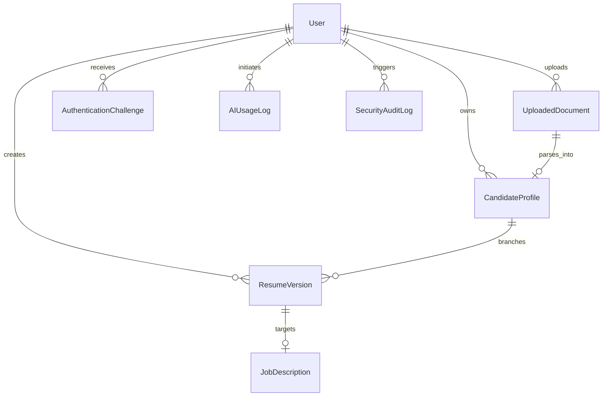

# ATS Resume Intelligence Studio - Database Schema

The database is built on MongoDB with Mongoose ODM, enforcing strict schema typing, field validation, unique constraints, and optimized indexes.

---

## 1. Entity Relationship Diagram (ERD)



---

## 2. Model Definitions & Schemas

### 2.1 User (`users`)
```typescript
{
  _id: ObjectId,
  fullName: { type: String, required: true, trim: true },
  email: { type: String, required: true, unique: true, lowercase: true, trim: true },
  passwordHash: { type: String, required: true },
  isEmailVerified: { type: Boolean, default: false },
  emailVerifiedAt: { type: Date, default: null },
  role: { type: String, enum: ['user', 'admin'], default: 'user' },
  status: { type: String, enum: ['active', 'suspended', 'pending_verification'], default: 'pending_verification' },
  securityQuestion: {
    question: { type: String, default: null },
    answerHash: { type: String, default: null }
  },
  passwordChangedAt: { type: Date, default: Date.now },
  createdAt: { type: Date, default: Date.now },
  updatedAt: { type: Date, default: Date.now }
}
```
**Indexes**:
- `{ email: 1 }` (unique)
- `{ createdAt: 1 }`

---

### 2.2 AuthenticationChallenge (`auth_challenges`)
```typescript
{
  _id: ObjectId,
  userId: { type: ObjectId, ref: 'User', required: false },
  email: { type: String, required: true, lowercase: true, trim: true },
  challengeType: { type: String, enum: ['email_verification', 'password_reset', 'email_change'], required: true },
  hashedCode: { type: String, required: true },
  expiresAt: { type: Date, required: true, index: { expires: '1h' } }, // TTL index for automatic cleanup
  failedAttempts: { type: Number, default: 0 },
  maxAttempts: { type: Number, default: 5 },
  isConsumed: { type: Boolean, default: false },
  createdAt: { type: Date, default: Date.now }
}
```
**Indexes**:
- `{ email: 1, challengeType: 1, isConsumed: 1 }`
- `{ expiresAt: 1 }` (TTL expiration)

---

### 2.3 CandidateProfile (`candidate_profiles`)
```typescript
{
  _id: ObjectId,
  userId: { type: ObjectId, ref: 'User', required: true, index: true },
  profileTitle: { type: String, default: 'Master Profile' },
  personalDetails: {
    fullName: { type: String, required: true },
    email: { type: String, required: true },
    phone: { type: String, default: '' },
    headline: { type: String, default: '' },
    address: { type: String, default: '' },
    city: { type: String, default: '' },
    state: { type: String, default: '' },
    country: { type: String, default: '' },
    postalCode: { type: String, default: '' },
    preferredLocation: { type: String, default: '' },
    linkedinUrl: { type: String, default: '' },
    githubUrl: { type: String, default: '' },
    portfolioUrl: { type: String, default: '' }
  },
  professionalSummary: { type: String, default: '' },
  education: [{
    qualification: { type: String, required: true },
    specialization: { type: String, default: '' },
    institution: { type: String, required: true },
    universityBoard: { type: String, default: '' },
    startDate: { type: String, default: '' },
    endDate: { type: String, default: '' },
    gradePercentageCgpa: { type: String, default: '' },
    academicAchievements: [{ type: String }],
    coursework: [{ type: String }],
    includeInResume: { type: Boolean, default: true }
  }],
  workExperience: [{
    employer: { type: String, required: true },
    jobTitle: { type: String, required: true },
    employmentType: { type: String, default: 'Full-time' },
    location: { type: String, default: '' },
    startDate: { type: String, required: true },
    endDate: { type: String, default: 'Present' },
    isCurrent: { type: Boolean, default: false },
    duration: { type: String, default: '' },
    responsibilities: [{ type: String }],
    achievements: [{ type: String }],
    technologies: [{ type: String }],
    includeInResume: { type: Boolean, default: true }
  }],
  projects: [{
    name: { type: String, required: true },
    category: { type: String, enum: ['Academic', 'Professional', 'Personal', 'Open-Source'], default: 'Professional' },
    role: { type: String, default: '' },
    startDate: { type: String, default: '' },
    endDate: { type: String, default: '' },
    description: { type: String, default: '' },
    responsibilities: [{ type: String }],
    technologies: [{ type: String }],
    url: { type: String, default: '' },
    includeInResume: { type: Boolean, default: true }
  }],
  skills: {
    technicalSkills: [{ type: String }],
    jobSkills: [{ type: String }],
    computerSkills: [{ type: String }],
    languages: [{ name: String, proficiency: String }],
    additionalSkills: [{ type: String }]
  },
  certifications: [{
    title: { type: String, required: true },
    issuer: { type: String, required: true },
    issueDate: { type: String, default: '' },
    credentialId: { type: String, default: '' },
    credentialUrl: { type: String, default: '' }
  }],
  businessExperience: [{
    businessName: { type: String },
    industry: { type: String },
    role: { type: String },
    duration: { type: String },
    responsibilities: [{ type: String }]
  }],
  currentOccupation: {
    status: { type: String, enum: ['Employed', 'Self-employed', 'Freelancer', 'Business Owner', 'Student', 'Job Seeker', 'Career Break', 'Other'], default: 'Employed' },
    notes: { type: String, default: '' }
  },
  careerGaps: [{
    startDate: { type: String },
    endDate: { type: String },
    reasonCategory: { type: String, enum: ['Freelance', 'Personal Projects', 'Education/Certifications', 'Family/Health', 'Career Break', 'Other'] },
    explanation: { type: String },
    includeInResume: { type: Boolean, default: false }
  }],
  declaration: {
    enabled: { type: Boolean, default: false },
    text: { type: String, default: 'I hereby declare that all the information provided above is true and accurate to the best of my knowledge.' }
  },
  uncategorizedInformation: [{ type: String }],
  createdAt: { type: Date, default: Date.now },
  updatedAt: { type: Date, default: Date.now }
}
```

---

### 2.4 ResumeVersion (`resume_versions`)
```typescript
{
  _id: ObjectId,
  userId: { type: ObjectId, ref: 'User', required: true, index: true },
  candidateProfileId: { type: ObjectId, ref: 'CandidateProfile', required: true },
  title: { type: String, required: true },
  targetRole: { type: String, default: '' },
  targetCategory: { type: String, default: 'General' },
  templateId: { type: String, required: true, default: 'classic-professional' },
  sectionOrder: [{ type: String }],
  sectionVisibility: { type: Map, of: Boolean, default: {} },
  customContentOverrides: { type: mongoose.Schema.Types.Mixed, default: {} },
  formatting: {
    pageSize: { type: String, enum: ['A4', 'Letter'], default: 'A4' },
    fontFamily: { type: String, default: 'Roboto' },
    fontSizePt: { type: Number, default: 10 },
    lineSpacing: { type: Number, default: 1.25 },
    marginsMm: { type: Number, default: 15 },
    accentColor: { type: String, default: '#1e293b' }
  },
  atsScore: { type: Number, default: 0 },
  createdAt: { type: Date, default: Date.now },
  updatedAt: { type: Date, default: Date.now }
}
```

---

### 2.5 AIUsageLog (`ai_usage_logs`)
```typescript
{
  _id: ObjectId,
  userId: { type: ObjectId, ref: 'User', index: true },
  feature: { type: String, required: true },
  model: { type: String, required: true },
  promptTokens: { type: Number, default: 0 },
  candidatesTokens: { type: Number, default: 0 },
  totalTokens: { type: Number, default: 0 },
  durationMs: { type: Number, default: 0 },
  success: { type: Boolean, default: true },
  errorCategory: { type: String, default: null },
  estimatedCostUsd: { type: Number, default: 0 },
  createdAt: { type: Date, default: Date.now, index: true }
}
```

---

### 2.6 SecurityAuditLog (`security_audit_logs`)
```typescript
{
  _id: ObjectId,
  userId: { type: ObjectId, ref: 'User', required: false },
  ipAddress: { type: String, required: true },
  userAgent: { type: String, default: '' },
  action: { type: String, required: true },
  status: { type: String, enum: ['success', 'failure', 'blocked'], required: true },
  metadata: { type: mongoose.Schema.Types.Mixed, default: {} },
  createdAt: { type: Date, default: Date.now, index: true }
}
```
